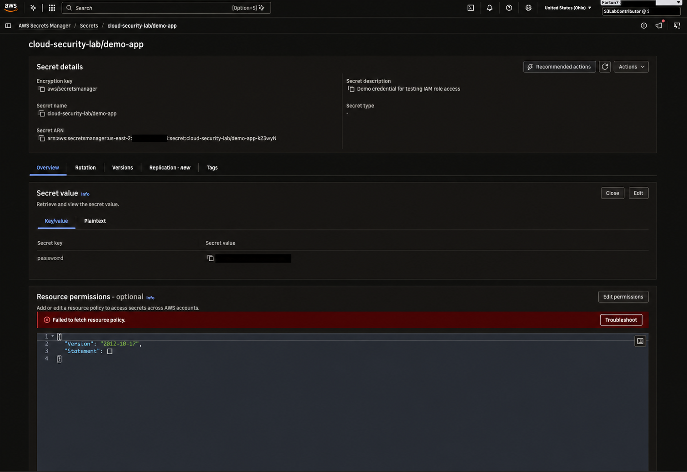
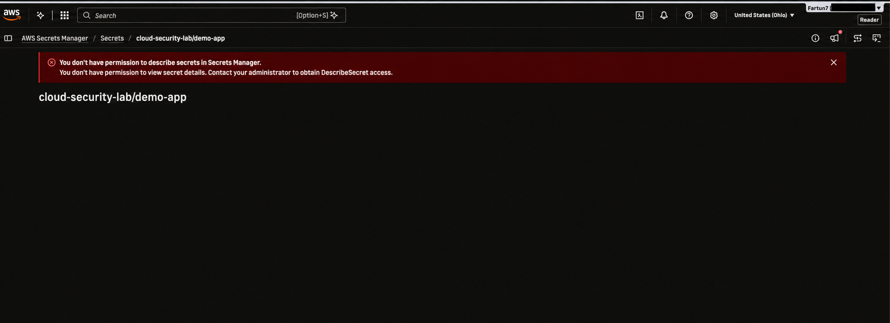

# AWS Secrets Manager Least-Privilege Access Lab

This cloud security lab demonstrates how AWS IAM roles can control access to a secret stored in AWS Secrets Manager. I tested two roles against the same secret to verify that authorized access succeeded and unauthorized access was denied.

## What I configured

- Created a demonstration secret in AWS Secrets Manager.
- Used the AWS-managed `aws/secretsmanager` encryption key.
- Granted `S3LabContributor` permission to:
  - `secretsmanager:DescribeSecret`
  - `secretsmanager:GetSecretValue`
- Scoped the permissions to one specific secret.
- Left `S3LabReader` without Secrets Manager permissions.
- Used a fake credential created only for this lab.

## Test results

| Test | Contributor | Reader |
|---|---|---|
| View secret details | Allowed | Denied |
| Retrieve secret value | Allowed | Denied |
| Access unrelated secrets | Not allowed | Not allowed |

## Contributor access allowed

The Contributor role successfully retrieved the demonstration secret.

## Reader access denied

The Reader role was denied access to the secret because it did not have `secretsmanager:DescribeSecret` or `secretsmanager:GetSecretValue`.

## Security controls demonstrated

- Role-based access control
- Least-privilege IAM permissions
- Resource-level permission scoping
- Secrets encryption at rest
- Separation of duties
- Positive and negative access testing

## What I learned

This lab showed that storing a credential in Secrets Manager does not automatically make it available to every AWS identity. Access must be explicitly granted through IAM. The same secret was accessible to the authorized Contributor role and denied to the Reader role, demonstrating that secret access can be controlled independently from S3 permissions.

## Security note

This project used a fake demonstration credential. The AWS account number and secret value were removed from the screenshots before publication.
